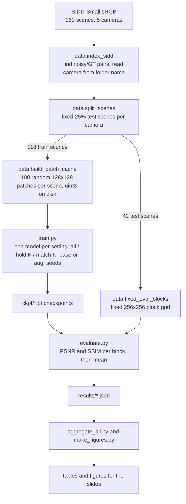
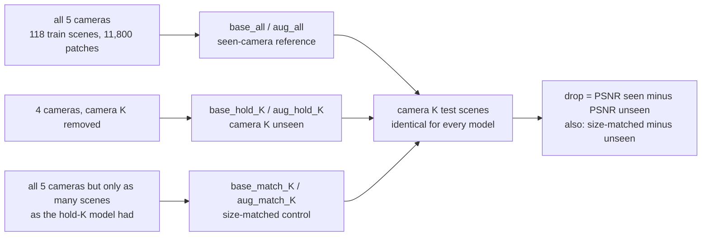
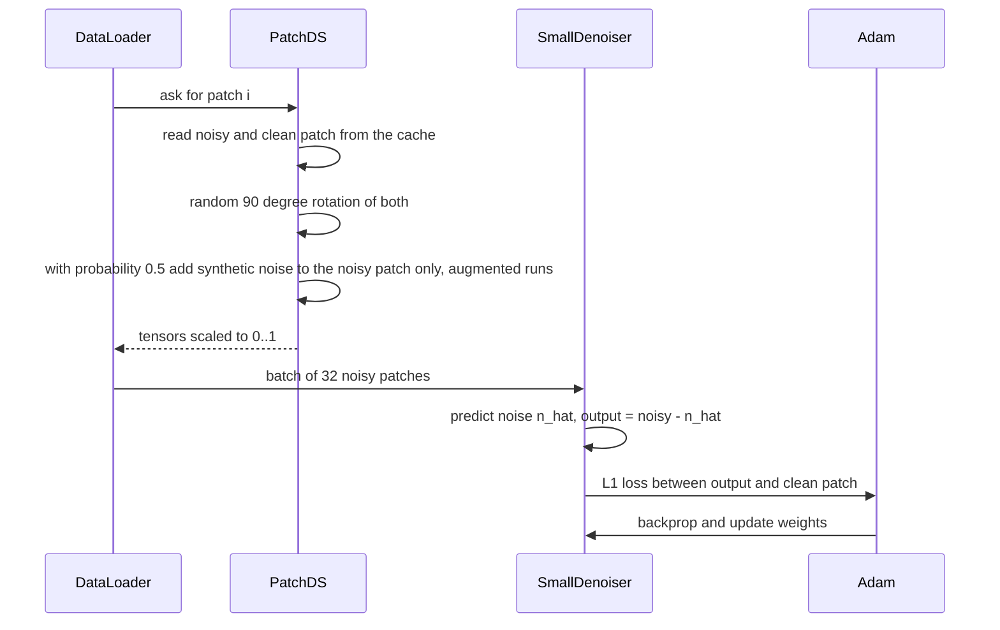
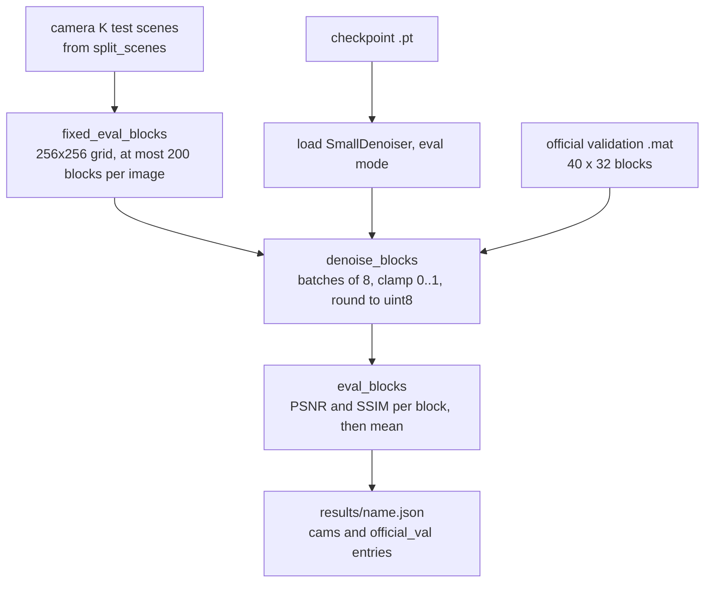
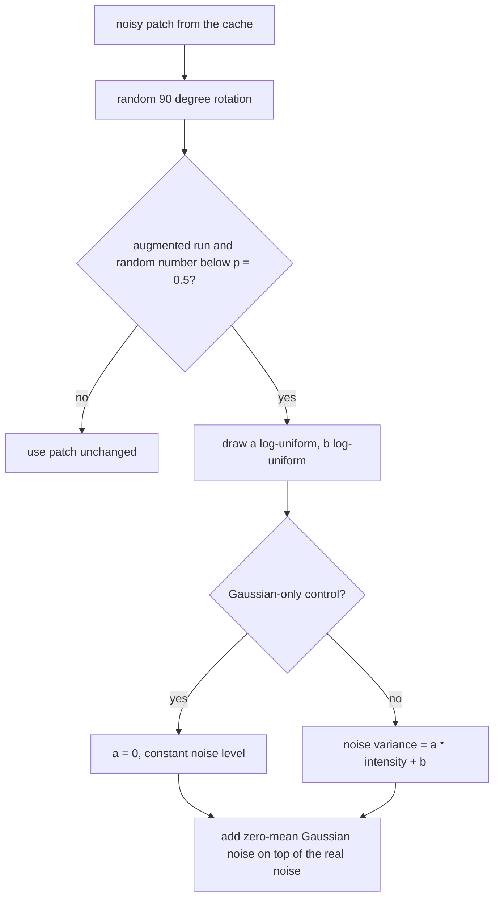
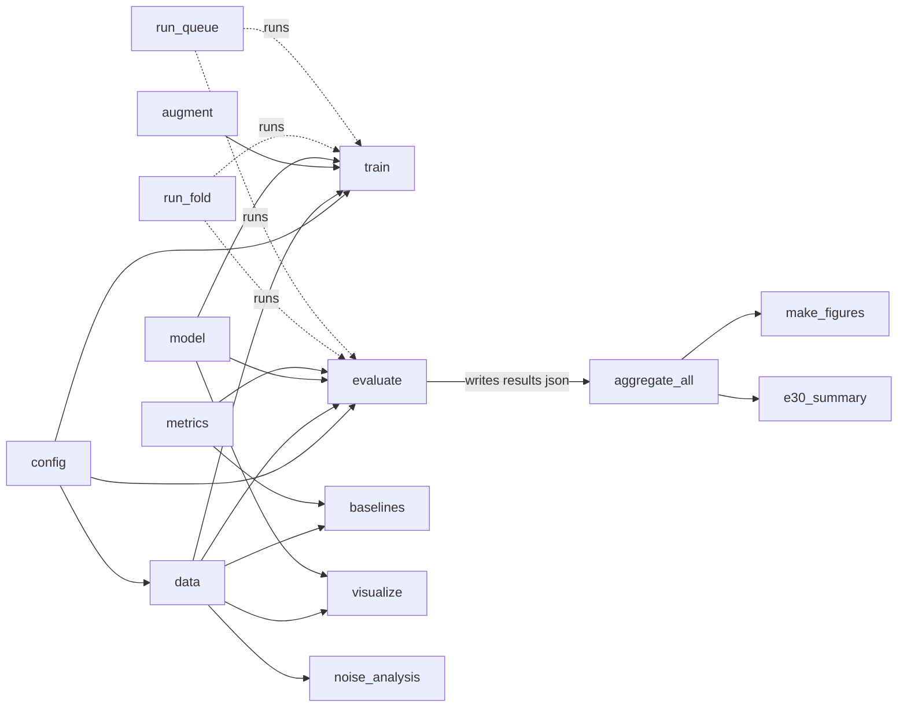

# NoiseShift-X: code walkthrough, use case of every file, and diagrams

How to use: read section 1 (the big picture), then section 2 (what each file is for and why we need it), then section 4 (function by function). Section 5 has the code questions a teacher is likely to ask. The diagrams are written in Mermaid: they render automatically on GitHub, in VS Code with a Mermaid extension, and at mermaid.live (paste the code block).

Settings quoted below (patch 128, 100 patches per image, test fraction 0.25, 10 epochs, seed 0) all live in `config.py`.

---

## 1. The big picture

### 1.1 End-to-end pipeline

### 1.2 Which models exist and how they are compared

### 1.3 One training step (what `train.py` does for every mini-batch)

### 1.4 One evaluation (what `evaluate.py` does)

### 1.5 The noise augmentation decision

### 1.6 Which file uses which

---

## 2. Use case of every file: what it does and why we need it

| File | What it does | Why the project needs it | If asked "why?" |
|---|---|---|---|
| `config.py` | Holds paths (all relative to the file) and the settings every run shares: patch size, patches per image, evaluation block size, test fraction, epochs, seed, the five camera codes | One place for the settings, so every model is trained and tested identically; changing one number here changes the whole experiment | "Comparisons are only fair if all models use the same settings, so we centralised them." |
| `data.py` | Finds the noisy/clean image pairs, reads the camera from the folder name, makes the fixed train/test scene split, builds the patch cache, and cuts the fixed evaluation blocks | Real photos are 12 megapixels and cannot be fed to a network directly; we need aligned patches for training and a deterministic evaluation grid | "Patches make training feasible; the fixed grid avoids arbitrary crops." |
| `model.py` | Defines `SmallDenoiser`, the 10-layer residual CNN (about 0.3 M parameters) | The single backbone shared by every model, so differences between models come from the training data and augmentation, not the network | "Same backbone, so any change in results is due to our method." |
| `augment.py` | Adds synthetic Poisson-Gaussian noise (or the Gaussian-only control) to a noisy patch | This is the idea we test: more noise levels in training | "It tests whether seeing more noise levels helps on an unseen camera." |
| `metrics.py` | PSNR, SSIM, mean over blocks, the drop formula, and the loader for the official `.mat` blocks | Defines exactly how quality is measured, once, for all experiments | "One definition of PSNR and SSIM, used everywhere." |
| `train.py` | Trains one model: all cameras, or one camera held out, or the size-matched control, baseline or augmented, any seed; saves a checkpoint every epoch and can resume | Produces every one of the models in the study | "Every row in our tables is one run of this script with different options." |
| `evaluate.py` | Loads a checkpoint and scores it on a camera's test scenes and/or the official validation blocks; saves JSON | Turns a checkpoint into numbers | "Test scenes were never trained on." |
| `run_fold.py` | Runs train then evaluate for one camera (baseline and augmented) or for the all-camera models | Launched the first 12 main models | "A convenience wrapper so a whole fold is one command." |
| `run_queue.py` | Runs the remaining 34 jobs (Gaussian control, seeds, size-matched, seen-model seeds), skips finished ones, safe to stop and restart | Let us run about 12 hours of experiments unattended | "Resumable queue; finished jobs are skipped." |
| `aggregate_all.py` | Reads `results/*.json` and builds the three tables (unseen performance, Gaussian control, drop) plus the gain chart | Turns hundreds of numbers into the tables on the slides, with mean and standard deviation over seeds | "Means and standard deviations over 3 seeds." |
| `make_figures.py` | Draws three slide figures from the results: unseen PSNR with error bars, drop per camera, method comparison | The visuals for the results slides | "Figures are generated from the same result files as the tables." |
| `visualize.py` | Draws noisy / baseline / augmented / ground truth for one test block with zoom and error maps | The qualitative result | "A single block is an illustration, not the average." |
| `noise_analysis.py` | Measures noise level vs ISO, noise variance vs intensity, and neighbour correlation for each camera | Answers "what noise does the dataset contain?" | "It shows noise differs between cameras and is not white." |
| `baselines.py` | Runs Gaussian blur, median, Non-Local Means and BM3D on the same blocks as the learned models, with a blind and an oracle noise level | Answers "which standard methods did you investigate and how do they compare?" | "Classical methods need a noise level; we give them a blind estimate and the true value." |
| `benchmark_submit.py` | Denoises the official benchmark blocks and writes the Kaggle submission CSV | The official-protocol score on hidden ground truth | "The ground truth is hidden, so Kaggle scores it." |
| `official_summary.py` | Averages the official validation-block scores over seeds | The 3-seed official number | "Mean ± std over seeds 0, 1, 2." |
| `e30_summary.py` | Averages the 30-epoch S6 runs over seeds | The training-length check | "Shows the augmentation gain disappears with longer training." |
| `test_synthetic.py` | Builds a tiny fake dataset and checks the split, cache, blocks, PSNR, SSIM and augmentation | Catches bugs without needing the real data or a GPU | "Six sanity checks; PSNR must match the closed form." |
| `requirements.txt` | Lists the Python packages | Anyone can recreate the environment | |
| `README.md`, `docs/` | Project summary, findings, setup; context and study guide | Hand-off and explanation | |
| `results/`, `logs/` | Final JSON results, tables, figures; raw training logs | Evidence and reproducibility | "Every number on the slides comes from a file here." |
| `.gitignore` | Keeps the dataset, checkpoints, Kaggle CSVs and `.venv` out of Git | They are large | |

---

## 3. Key design ideas the code implements (explain these first)
1. **Fixed test scenes** (`split_scenes`): about 25% of each camera's scenes are reserved with a seeded random choice, so every model, on every machine, is tested on the same scenes it never trained on.
2. **Hold-out camera** (`--hold K`): the cache is built once from the train scenes of all cameras; holding out camera K just removes its patches from the indices used for training.
3. **Patch cache on disk** (`build_patch_cache`): random aligned crops stored as uint8 in memory-mapped files; only one full image is in RAM at a time. (An earlier version stored every patch in RAM and crashed.)
4. **Residual learning** (`SmallDenoiser.forward`): the network predicts the noise and returns `input - predicted noise`.
5. **Exact resume** (`train.py`): the learning rate is set explicitly each epoch from the cosine formula, and a checkpoint is saved after every epoch.
6. **Seeds**: `--seed` changes weight initialisation, data order and augmentation noise but never the test split.

---

## 4. Function by function

### 4.1 `config.py`
Variables, not functions. `BASE` is the folder of the file, so paths work on any machine. `DATA = BASE/content` holds the dataset. `CAMERAS = [GP, IP, S6, N6, G4]`. `PATCH = 128`, `PATCHES_PER_IMAGE = 100`, `EVAL_BLOCK = 256`, `TEST_FRAC = 0.25`, `EPOCHS = 10`, `SEED = 0`.
**Likely question:** "Why 100 patches per image?" It gives 11,800 training patches (118 scenes), enough for 10 epochs without filling memory; more patches would cost more time.

### 4.2 `data.py`
| Function | Input → output | What it does and why |
|---|---|---|
| `parse_camera(folder_name)` | folder name → camera code | Takes the 3rd underscore-separated field (`0001_001_S6_...` gives `S6`); raises an error for unexpected names |
| `_find_pair(folder)` | scene folder → lists of noisy and GT file paths | Searches `*NOISY*SRGB*` and `*GT*SRGB*` PNGs; the `set()` removes duplicates because Windows treats `.PNG` and `.png` as the same pattern (a bug we fixed) |
| `index_sidd(root)` | dataset root → list of dicts `{camera, folder, noisy, gt}` | One entry per scene folder; stops with an error if a folder doesn't have exactly one noisy and one GT file |
| `split_by_camera(items, held_out)` | items, camera → (train, test) | Old whole-camera split, kept for the test; the reported experiments don't use it |
| `split_scenes(items, test_frac, seed)` | items → (train, test) | For each camera: sort its scenes, pick `min(n-1, max(3, ceil(0.25 n)))` test scenes with a seeded random generator; the rest are train. Gives IP 14/40, S6 9/26, GP 9/24, N6 6/16, G4 4/12 |
| `load_png(path)` | file → uint8 H×W×3 array | Reads an image as RGB |
| `build_patch_cache(items, prefix, size, per_image, seed)` | train items → files on disk, returns number of patches | Creates `<prefix>_noisy.npy`, `_gt.npy`, `_cam.npy`; for each scene cuts `per_image` random patches at the same position in the noisy and clean image, so each pair is pixel-aligned; writes `_cam.npy` last so a crash leaves no "complete" marker |
| `cache_ready(prefix)` | prefix → bool | True only if all three files exist |
| `load_cache(prefix, held_out)` | prefix → (noisy array, clean array, camera array, indices) | Memory-maps the arrays and returns the indices of patches whose camera is not the held-out one |
| `fixed_eval_blocks(noisy, gt, block, max_blocks)` | full images → list of (noisy block, GT block) | Non-overlapping 256×256 grid in reading order, no randomness, partial edge blocks are dropped; `max_blocks` keeps only the first blocks |
**Likely questions:** "How do you avoid leakage?" The test scenes are removed before the cache is built, so test patches never exist in the training files. "Why not random test crops?" Random crops would make results depend on luck and aren't comparable; a fixed grid is deterministic.

### 4.3 `model.py`: `SmallDenoiser(ch=64, depth=10)`
- **`__init__`:** builds `Conv(3→64) + ReLU`, then 8 × `Conv(64→64) + BatchNorm + ReLU`, then `Conv(64→3)`, all 3×3 with padding, in a `Sequential`. About 0.3 million parameters, receptive field 21×21 (2·10+1).
- **`forward(x)`:** returns `x - self.net(x)`. The last layer outputs the predicted noise; subtracting it gives the denoised image (residual learning).
**Likely questions:** "Why predict the noise?" The noise is a simpler, lower-energy signal than the image, so it is easier to learn (DnCNN). "Why batch norm?" It stabilises training; remember `model.eval()` makes it use running statistics at test time.

### 4.4 `augment.py`
- **`add_poisson_gaussian(noisy_u8, rng, a_range, b_range, gauss_only)`:** converts the patch to [0,1], draws `a` and `b` log-uniformly (`a = 0` when `gauss_only`), computes per-pixel standard deviation `sqrt(a·x + b)`, adds Gaussian noise with that spread, clips to [0,255], returns the new patch and `(a, b)`.
- **`maybe_augment(noisy_u8, rng, p, **kw)`:** with probability `p` (0.5) applies the function above; otherwise returns the patch unchanged.
**Likely questions:** "Why log-uniform?" It covers small and large noise levels evenly on a log scale. "Why add on top of the real noise?" The real noise is already in the input; the extra noise raises the level, and the target stays the clean image. "Where is the clean image's noise?" It isn't touched: only the input is modified.

### 4.5 `metrics.py`
| Function | What it does |
|---|---|
| `psnr(a, b)` | Rescales uint8 images to [0,1], MSE, then `10·log10(1/MSE)`; infinity if identical |
| `ssim(a, b)` | scikit-image structural similarity on the RGB block, `data_range=255` |
| `eval_blocks(pred, gt)` | PSNR and SSIM per block, then the mean over blocks (not PSNR of a pooled MSE) |
| `cross_camera_drop(seen, unseen)` | `seen - unseen`; the actual drop tables are built in `aggregate_all.py` |
| `load_official_blocks(noisy_mat, gt_mat)` | Reads the official validation `.mat` files (40×32×256×256×3) and flattens them to 1280 blocks |
**Likely question:** "Why average per block?" It treats every block equally and is simple to reproduce; the official benchmark also uses blocks.

### 4.6 `train.py`
**Class `PatchDS` (PyTorch Dataset):**
- `__init__`: stores the memory-mapped arrays, the allowed indices, whether to augment, probability `p`, and the noise ranges (scaled by `aug_mult`; the Gaussian control uses `a = 0` and its own `b` range).
- `__len__`: number of allowed patches.
- `__getitem__(i)`: seeds a random generator the first time it is called (from `torch.initial_seed()`, so each worker and epoch differs); reads patch `idx[i]`; rotates the noisy and clean patch by the same random multiple of 90°; if augmenting, calls `maybe_augment` on the noisy patch only; converts both to float tensors 3×H×W in [0,1].

**`main()` step by step:**
1. Parse options: `--name`, `--hold K`, `--aug`, `--aug_gauss`, `--aug_p`, `--aug_mult`, `--match K`, `--seed`, `--epochs`, `--bs` (32), `--lr` (1e-3), `--workers` (0).
2. Set the seed; create `ckpt/`, cache and `results/` folders.
3. If the shared cache (`trainval_*.npy`) doesn't exist, build it from the **train** scenes only.
4. `load_cache(prefix, hold)` gives the training indices (held-out camera removed) and a safety `assert` confirms it.
5. If `--match K`: keep only as many randomly chosen scenes (deterministic seed) as the hold-K model would use, but from all cameras including K; scene number = patch index // 100.
6. Build the dataset, `DataLoader` (shuffle, drop incomplete batch), model and Adam optimiser.
7. Resume: if the checkpoint exists, load weights, optimiser and epoch; the loss history is cut back to that epoch.
8. For each epoch: set the learning rate `lr0·0.5·(1+cos(π e/E))`; for each batch: move to GPU, zero gradients, forward, L1 loss against the clean patch, backward, optimiser step; record the mean loss; save the checkpoint and `results/<name>_loss.json`.
**Likely questions:** "What happens if training is interrupted?" It resumes from the last finished epoch. "What does `--hold` do technically?" Removes that camera's patch indices. "Why drop the last incomplete batch?" To keep batch statistics stable for batch norm. "Why `workers=0`?" Windows spawns workers and would copy the memory-mapped data into each; zero workers is simpler and fast enough here.

### 4.7 `evaluate.py`
- **`denoise_blocks(model, blocks, dev, bs)`:** converts batches of uint8 blocks to tensors in [0,1], runs the network without gradients, clamps to [0,1], multiplies by 255, rounds to uint8, returns the list of denoised blocks.
- **`main()`:** loads the checkpoint into `SmallDenoiser` and sets eval mode; loads or creates `results/<ckpt>.json`; with `--official`, scores the official validation blocks and stores `official_val`; with `--cams`, takes that camera's **test** scenes from `split_scenes`, builds fixed blocks (at most 200 per image), denoises and scores them, and stores `{psnr, ssim, n_images, n_blocks}` under `cams`; saves the JSON (existing entries are kept, so evaluations accumulate).
**Likely questions:** "Why round to uint8?" So the output is exactly what would be saved as an image. "Why at most 200 blocks per image?" To bound evaluation time; large images are still covered almost completely.

---

## 5. The other scripts, in brief
- **`run_fold.py`** `all` or camera: calls `train.py` then `evaluate.py` for `base` and `aug` (for `all` it also evaluates on all five cameras and the official blocks).
- **`run_queue.py`:** `queue(phases)` builds job dictionaries (name, training arguments, cameras to evaluate); `done()` checks whether a job's JSON already has the entries; the main loop skips finished jobs, then runs training and evaluation. Phases: `gauss`, `seeds`, `match`, `allseeds` (and optional `gaussseeds`).
- **`aggregate_all.py`:** `get` reads one metric from a JSON; `seeds` gathers seed 0 (`name`) and seeds 1, 2 (`name_s1`, `name_s2`); `ms` returns mean, sample standard deviation and count; `paired` subtracts per seed; `main` writes the three tables (`summary_full.md`) and `gain_bars.png`.
- **`make_figures.py`:** `fig_unseen_seeds.png`, `fig_drop.png`, and `fig_methods.png` (needs `baselines.csv`).
- **`visualize.py`:** loads the baseline and augmented hold-out models of one camera, runs one block through both, saves a 3×4 figure.
- **`noise_analysis.py`:** samples 200,000 pixels per image; bins the ground-truth intensity into 32 bins; accumulates the noise variance per bin and camera; measures lag-1 correlation in a central crop; saves two plots and `noise_stats.csv`. The fitted straight line in its output is only indicative because the curves are not linear.
- **`baselines.py`:** Gaussian blur σ = 1, median 3×3, NLM, BM3D (blind noise level from `estimate_sigma`; oracle level = std of noisy minus ground truth), plus the trained models, on `per_scene` evenly spread blocks per test scene.
- **`benchmark_submit.py`:** `load_blocks` reads the benchmark `.mat`; `save_csv` writes one base64 row per block (ID 0 to 1279); `check_csv` re-reads and verifies it.
- **`test_synthetic.py`:** builds ten fake scenes and checks indexing, the split (disjoint, deterministic), the cache and held-out filtering, fixed blocks, PSNR against the closed form, SSIM of identical images, and that augmentation noise grows with brightness.

---

## 6. Code questions to practise (answer in 2-3 sentences)
1. What happens when you run `python train.py --name base_hold_S6 --hold S6`? 2. How does the code know which camera an image came from? 3. How are the test scenes chosen and how do you know no test patch is in training? 4. Why is the cache built once for all folds? 5. What does `load_cache` return? 6. Why must `build_patch_cache` use the same position for the noisy and clean image? 7. What does `SmallDenoiser.forward` return? 8. How many parameters and what receptive field? 9. What does `maybe_augment` do and when is it called? 10. What is different in the Gaussian-only control? 11. Where is the cosine schedule and why is it set explicitly? 12. How does resume work? 13. What does `--match` do and why? 14. How are PSNR and SSIM computed and averaged? 15. Why `model.eval()` before evaluating? 16. What is stored in a results JSON? 17. How does `aggregate_all.py` combine seeds? 18. What is the difference between the blind and oracle noise level in `baselines.py`? 19. How is the Kaggle CSV encoded? 20. What does `test_synthetic.py` prove and what does it not prove? (It proves the logic on fake data; it doesn't test the real data or training quality.) 21. Which bugs did you find and fix? (RAM crash from storing every patch; Windows duplicate-file bug; corner-only baseline blocks; learning-rate bug on resume.) 22. Why `seed` for training but a fixed seed for the split?

## 7. Mistakes we fixed (be ready to mention)
Patch cache held every patch in RAM and crashed (now random patches on disk); Windows glob matched files twice (now de-duplicated); baselines first used only corner blocks (now evenly spread); resuming an interrupted run double-decayed the learning rate (now set explicitly per epoch; only the 3×-noise ablation was affected); the first drop definition compared different cameras and the second used training scenes (now fixed test scenes and same-scene comparison).
